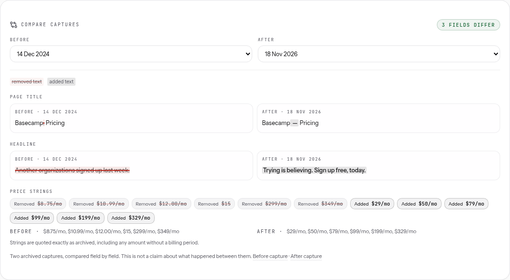
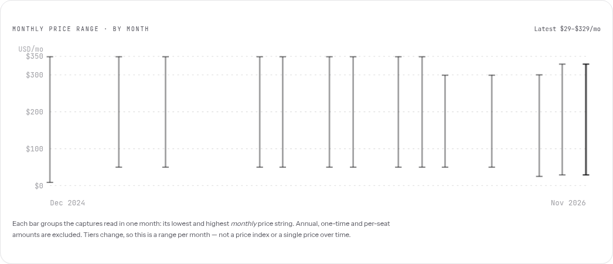

# Growth Documentary

[](https://github.com/Niraven/growth-documentary/actions/workflows/ci.yml)
[](LICENSE)

**A dated, sourced record of what changed on a public page.**

Paste a pricing page. Get a timeline of what changed on it, with the archived page behind every line. No estimates, no causal claims, no dashboard — just receipts you can quote.

```
basecamp.com/pricing → 17 of 392 listed captures → 10 field changes → a link that proves each one
```


## Why

Competitive research usually produces one of two things: a screenshot with no date, or a confident story with no source. Growth Documentary produces the boring middle: **this string was on the page on this date, that string was there later, here is the archive link.**

It is useful when someone asks *"says who?"* — in a pitch, a board deck, a teardown or a sales call.

## Quickstart

```bash
pnpm install
pnpm dev          # http://127.0.0.1:5173
```

Production build, with the same API mounted:

```bash
pnpm build
pnpm start        # http://127.0.0.1:5191
```

Reports are shareable: `/?url=slack.com/pricing` re-runs the same archive query for that target on load. [Saved reports](#saved-reports-and-export) get a stable link instead.

Requirements: Node 22.12+ and `pnpm`. No API keys, no database, no account.

## What a report contains

**Coverage.** The period the report actually covers, how many captures were read, how many the index listed, and a strip that marks every capture read and every day a change was found. Gaps are visible on purpose: the space between dots is unread, not unchanged.

**Changes.** Consecutive readable captures are compared field by field. The first row is the baseline, not a change. Same-day field changes are grouped under one date.

**Compare.** Pick any two captures and see them side by side. The page title uses a character-level diff (`Basecamp: Pricing` → `Basecamp — Pricing`); the headline uses a word-level diff, and a wholesale replacement is shown as two whole states rather than an invented sentence. Price removals and additions are labelled, not encoded as negative numbers.



**Monthly price range.** When at least two months contain monthly price strings, a small chart shows one bar per month: the lowest and highest monthly amount read that month. Annual, one-time and per-seat amounts are excluded; the caption says it is a range, not an index.



**Citation.** One button copies a ready-to-paste citation with the coverage window, captures read, field changes, access date and source link.

**Site size.** In parallel, the site's archived sitemap is read for a page count and — when the site publishes `lastmod` dates — additions per month. When those dates cluster into one month, the panel says so instead of drawing a growth curve the data cannot support.

For each capture it extracts three things:

| Field | Source |
|---|---|
| Page title | `<title>` |
| Headline | first `<h1>` |
| Prices | `$`-prefixed strings, filtered and deduped |

Then it compares consecutive captures and keeps only observed differences. A field that disappears is not reported as a change — an unreadable capture is a gap, not a deletion.

## Saved reports and export

**Save report** freezes a server-computed report for that URL — captures, changes, coverage — in `data/reports.json` on the machine running the server. If the same URL was just built, the 10-minute cache is reused; otherwise the server computes a fresh one. The saved copy is never recomputed on read. It gets an id and a stable link (`#report/<id>`), so it can be reopened later even after a rebuild would produce different data.

Saved reports are local only: one JSON file, at most 200, atomic writes, `0600`. There is no account and no upload. The id is random, not guessable, but it is also not a permission system — anyone who can reach the server can read saved reports.

**Export** writes the loaded report to CSV or JSON in the browser. CSV columns: `date, timestamp, field, before, after, capture_url`. Cells that begin with `=`, `+`, `-` or `@` are prefixed with an apostrophe so a spreadsheet treats them as text.

## Live check (optional, never a dated change)

The report has a **Check the live page** button. It reads the target once, on demand, and shows the current title, headline and price strings. It does not run automatically and it is never merged into the timeline:

- The request happens only after `robots.txt` allows that path.
- The host must resolve only to public addresses; redirects must stay on the same host.
- No cookies, no credentials, no JavaScript, no paywall, 2 MB cap, 15-second budget.
- The result has no archive timestamp, so it cannot become a dated row.
- Comparing it with the latest capture answers "does the page differ from the archive right now?", not "when did it change?".

A difference against the latest capture is labelled as a comparison fact. The dated timeline still comes from the archive alone.

## What it does not do

- It does not tell you why a change happened, or whether it worked.
- It does not measure revenue, traffic or conversion.
- It does not know the exact day of a change — only that the page looked different by the next capture.
- It does not read pages behind a login or a paywall.
- It does not render a visual diff. Text fields only.
- It does not know a complete page count: the sitemap figure is what the site published, captured on a given date.
- It does not claim the sampled captures are every capture. The index is capped at 400 and the report shows what it read.
- A live check cannot prove history. It is a single read of the page now, not a capture.
- Saved reports are not multi-user: one process, one file, no auth, no sync.

Those limits are deliberate. A tool that guesses is worse than a tool that says "I only know these three things".

## API

```http
GET    /api
GET    /api/timeline?url=stripe.com/pricing
GET    /api/site?url=stripe.com/pricing
GET    /api/live?url=stripe.com/pricing
GET    /api/reports
POST   /api/reports            {"url":"stripe.com/pricing"}
GET    /api/reports/:id
DELETE /api/reports/:id
GET    /api/health
```

`GET /api` returns the endpoint list, version and docs link, so a client can discover the surface without reading source.

`200` returns:

```json
{
  "domain": "example.com",
  "path": "/pricing",
  "captures": [
    { "ts": "20200101000000", "label": "1 Jan 2020", "title": "Pricing", "h1": "Simple pricing", "prices": ["$79/mo"], "url": "https://web.archive.org/web/20200101000000/example.com/pricing" },
    { "ts": "20240104213453", "label": "4 Jan 2024", "title": "Pricing", "h1": "Simple pricing", "prices": ["$99/mo"], "url": "https://web.archive.org/web/20240104213453/example.com/pricing" }
  ],
  "changes": [
    { "ts": "20200101000000", "label": "1 Jan 2020", "field": "first capture", "before": "", "after": "Pricing", "url": "https://web.archive.org/web/20200101000000/example.com/pricing" },
    { "ts": "20240104213453", "label": "4 Jan 2024", "field": "price", "before": "$79/mo", "after": "$99/mo", "url": "https://web.archive.org/web/20240104213453/example.com/pricing" }
  ],
  "coverage": {
    "from": "20200101000000",
    "to": "20240104213453",
    "months": 49,
    "sampled": 2,
    "available": 2,
    "strategy": "adaptive"
  },
  "checkedAt": "2026-11-24T03:00:00.000Z"
}
```

`GET /api/site` answers with the sitemap layer, independently of the timeline:

```json
{
  "domain": "example.com",
  "sitemapUrl": "https://example.com/sitemap.xml",
  "archivedAt": "2024-06-01",
  "pages": 171,
  "dated": 171,
  "months": [{ "month": "2024-05", "added": 170 }],
  "children": 0,
  "note": "Archived sitemap captured 1 Jun 2024."
}
```

When no sitemap is archived, `sitemapUrl` is `null`, counts are zero and `note` says why. The timeline never depends on this call.

`POST /api/reports` computes (or reuses a cached) timeline and freezes it. `201` for a new save, `200` when the same snapshot is already saved:

```json
{ "id": "k8asos3U", "savedAt": "2026-11-24T05:58:28.995Z", "domain": "example.com", "path": "/pricing", "changes": 10 }
```

`GET /api/reports/:id` returns `{ id, savedAt, report }`; `DELETE` returns `204`.

`GET /api/live` is the opt-in read of the current page; it is never cached and never enters a timeline:

```json
{
  "domain": "example.com",
  "path": "/pricing",
  "fetchedAt": "2026-11-24T06:04:00.000Z",
  "finalUrl": "https://example.com/pricing",
  "title": "Plans & pricing",
  "h1": "Pick a plan",
  "prices": ["$20/mo", "$50/mo"],
  "robots": "allowed"
}
```

Status codes: `400` invalid target, `403` robots.txt disallows the live read, `404` nothing archived or no such saved report, `413` body over 16 kB or report too large to save, `415` live URL is not HTML, `429` rate limited, `502` archive or live page unreachable/unreadable, `504` timeout. Successful timelines are cached in memory for 10 minutes (`x-cache: hit|miss`).

Rate limits per client per minute: 8 timelines, 20 sitemap reads, 4 live checks, 6 saves. The quota keys on the socket address. Behind a reverse proxy every user shares the proxy's address, so either key on a trusted `X-Forwarded-For` or set the quota high enough for the whole proxy.

## Architecture

```
shared/timeline.ts   contract, guards, snapshot comparison, used by both sides
shared/compare.ts    word/char diff, capture comparison, monthly price parsing
src/                 React 19 UI (Vite, Tailwind 4, Radix, shadcn-style primitives)
  components/        report, coverage, price range, compare, saved list, live panel
  lib/export.ts      CSV (formula-safe) and JSON downloads
  lib/citation.ts    ready-to-paste citation
server/
  archive.ts         archive transport: CDX + snapshots, origin-locked
  core.ts            pure extraction, diff and adaptive sampling (no HTTP)
  site.ts            sitemap read, also through the archive
  live.ts            opt-in live read: DNS/IP guard, robots.txt, caps
  store.ts           saved reports: one JSON file, atomic writes, serialised
  api.ts             request handler: routes, validation, limits, caches
  plugin.ts          mounts the same handler on dev and preview servers
tests/               extraction, sampling, sitemap, live, store, export, handler
```

The API is a Vite plugin with `configureServer` **and** `configurePreviewServer`, so `pnpm dev` and `pnpm start` run identical server code. `server/core.ts`, `server/live.ts` and `server/store.ts` are framework-free and injectable.

Data source: [Internet Archive Wayback Machine](https://web.archive.org/) CDX + snapshot endpoints for the timeline. The optional live check contacts the target's own host once, on demand, after `robots.txt` permits it; it never feeds the dated timeline. The browser talks only to this server.

### Why the Archive, not a crawler

A crawler can tell you what a page says now. It cannot tell you what the page said on a date, because it was not there. The dated rows therefore come from the one public API that stores dated captures. A second historical source would need its own crawl date and provenance label before it could join a timeline; without that, it is a current-page read wearing a date's clothes.

When a page is not archived at all, the honest answer is "no captures", not a scrape dressed up as history. The live check is offered as a separate, clearly labelled current-page read.

Source matrix, planned adapters and the inclusion rule for adding a source: [`docs/SOURCES.md`](docs/SOURCES.md).

## Scripts

| Command | Does |
|---|---|
| `pnpm dev` | Dev server with HMR and the API |
| `pnpm build` | Type-check and build to `dist/` |
| `pnpm start` | Serve the production build with the API |
| `pnpm test` | 159 unit tests (vitest) |
| `pnpm lint` | oxlint |
| `pnpm a11y` | axe-core scan of a running build (0 violations at v0.5.0) |
| `pnpm check` | lint + test + build |

## Self-hosting

The app is a static build plus one Node process. It binds to `127.0.0.1` by default. Put it behind Tailscale, a reverse proxy or a private network — there is no auth layer, because it is designed to run on a private host. If you expose it publicly, add authentication and a per-IP quota in front of it.

Saved reports live in `data/reports.json`. Override with `GD_DATA_DIR` or `GD_REPORTS_FILE`. The store is single-process by design: do not run two writers against the same file.

Outbound access to `web.archive.org` is required. The optional live check adds user-triggered egress to the page's own public host, after DNS and robots.txt checks; it is the only path that leaves the archive.

## Roadmap

- A hosted, multi-user store (the current one is deliberately one file, one process)
- Optional licensed ad-library connector (Meta/Google) behind a provider key
- Visual diff of archived screenshots for a requested page
- More sources: hiring pages, docs changelogs, launch notes — each with its own provenance label

Not started, not claimed. The current build is the one described above.

## Contributing

See [CONTRIBUTING.md](CONTRIBUTING.md) and [SECURITY.md](SECURITY.md). The product spec lives in [docs/SPEC.md](docs/SPEC.md) — changes that widen scope should update it first. Release notes are in [CHANGELOG.md](CHANGELOG.md).

## License

MIT. See [LICENSE](LICENSE).
