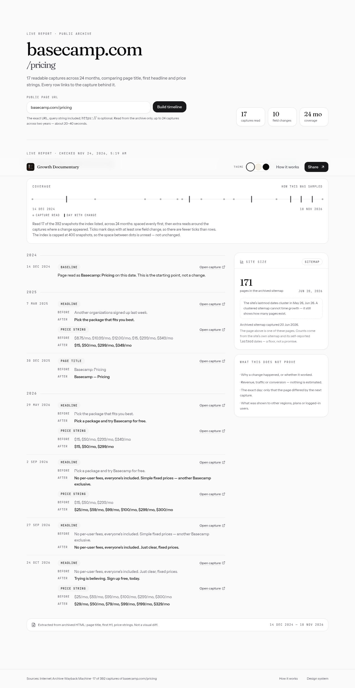

# Growth Documentary

[](https://github.com/Niraven/growth-documentary/actions/workflows/ci.yml)
[](LICENSE)

**A dated, sourced record of what changed on a public page.**

Paste a pricing page. Get a timeline of what changed on it, with the archived page behind every line. No estimates, no causal claims, no dashboard — just receipts you can quote.

```
basecamp.com/pricing → 17 of 392 listed captures → 10 field changes → a link that proves each one
```



## Why

Competitive research usually produces one of two things: a screenshot with no date, or a confident story with no source. Growth Documentary produces the boring middle: **this string was on the page on this date, that string was there later, here is the archive link.**

It is useful when someone asks *"says who?"* — in a pitch, a board deck, a teardown or a sales call.

## Quickstart

```bash
pnpm install
pnpm dev          # http://127.0.0.1:5173
```

Production build, with the same API mounted:

```bash
pnpm build
pnpm start        # http://127.0.0.1:5191
```

Reports are shareable: `/?url=slack.com/pricing` re-runs the same archive query for that target on load.

Requirements: Node 22.12+ and `pnpm`. No API keys, no database, no account.

## What a report contains

**Coverage.** The period the report actually covers, how many captures were read, how many the index listed, and a strip that marks every capture read and every day a change was found. Gaps are visible on purpose: the space between dots is unread, not unchanged.

**Changes.** Consecutive readable captures are compared field by field. The first row is the baseline, not a change. Same-day field changes are grouped under one date.

**Site size.** In parallel, the site's archived sitemap is read for a page count and — when the site publishes `lastmod` dates — additions per month. When those dates cluster into one month, the panel says so instead of drawing a growth curve the data cannot support.

For each capture it extracts three things:

| Field | Source |
|---|---|
| Page title | `<title>` |
| Headline | first `<h1>` |
| Prices | `$`-prefixed strings, filtered and deduped |

Then it compares consecutive captures and keeps only observed differences. A field that disappears is not reported as a change — an unreadable capture is a gap, not a deletion.

## What it does not do

- It does not tell you why a change happened, or whether it worked.
- It does not measure revenue, traffic or conversion.
- It does not know the exact day of a change — only that the page looked different by the next capture.
- It does not read pages behind a login or a paywall.
- It does not render a visual diff. Text fields only.
- It does not know a complete page count: the sitemap figure is what the site published, captured on a given date.
- It does not claim the sampled captures are every capture. The index is capped at 400 and the report shows what it read.

Those limits are deliberate. A tool that guesses is worse than a tool that says "I only know these three things".

## API

```http
GET /api/timeline?url=stripe.com/pricing
GET /api/site?url=stripe.com/pricing
GET /api/health
```

`200` returns:

```json
{
  "domain": "example.com",
  "path": "/pricing",
  "captures": [
    { "ts": "20200101000000", "label": "1 Jan 2020", "title": "Pricing", "h1": "Simple pricing", "prices": ["$79/mo"], "url": "https://web.archive.org/web/20200101000000/example.com/pricing" },
    { "ts": "20240104213453", "label": "4 Jan 2024", "title": "Pricing", "h1": "Simple pricing", "prices": ["$99/mo"], "url": "https://web.archive.org/web/20240104213453/example.com/pricing" }
  ],
  "changes": [
    { "ts": "20200101000000", "label": "1 Jan 2020", "field": "first capture", "before": "", "after": "Pricing", "url": "https://web.archive.org/web/20200101000000/example.com/pricing" },
    { "ts": "20240104213453", "label": "4 Jan 2024", "field": "price", "before": "$79/mo", "after": "$99/mo", "url": "https://web.archive.org/web/20240104213453/example.com/pricing" }
  ],
  "coverage": {
    "from": "20200101000000",
    "to": "20240104213453",
    "months": 49,
    "sampled": 2,
    "available": 2,
    "strategy": "adaptive"
  },
  "checkedAt": "2026-11-24T03:00:00.000Z"
}
```

`GET /api/site` answers with the sitemap layer, independently of the timeline:

```json
{
  "domain": "example.com",
  "sitemapUrl": "https://example.com/sitemap.xml",
  "archivedAt": "2024-06-01",
  "pages": 171,
  "dated": 171,
  "months": [{ "month": "2024-05", "added": 170 }],
  "children": 0,
  "note": "Archived sitemap captured 1 Jun 2024."
}
```

When no sitemap is archived, `sitemapUrl` is `null`, counts are zero and `note` says why. The timeline never depends on this call.

Status codes: `400` invalid target, `404` nothing archived, `429` rate limited (8 reports/minute per client), `502` archive unreachable or unreadable, `504` archive timeout. Successful reports are cached in memory for 10 minutes (`x-cache: hit|miss`).

The quota keys on the socket address. Behind a reverse proxy every user shares the proxy's address, so either key on a trusted `X-Forwarded-For` or set the quota high enough for the whole proxy.

## Architecture

```
shared/timeline.ts   the report contract and boundary guards, used by both sides
src/                 React 19 UI (Vite, Tailwind 4, Radix, shadcn-style primitives)
  components/        report, coverage strip, site panel, empty state, how-it-works
server/
  archive.ts         the only outbound transport: CDX + snapshots, origin-locked
  core.ts            pure extraction, diff and adaptive sampling (no HTTP)
  site.ts            sitemap read, also through the archive
  api.ts             request handler: validation, rate limit, two caches
  plugin.ts          mounts the same handler on dev and preview servers
tests/               extraction, sampling, sitemap, contract and handler tests
```

The API is a Vite plugin with `configureServer` **and** `configurePreviewServer`, so `pnpm dev` and `pnpm start` run identical server code. `server/core.ts` has no framework imports and is tested directly.

Data source: [Internet Archive Wayback Machine](https://web.archive.org/) CDX + snapshot endpoints. Nothing is scraped from the target site directly — the only host contacted is `web.archive.org`.

## Scripts

| Command | Does |
|---|---|
| `pnpm dev` | Dev server with HMR and the API |
| `pnpm build` | Type-check and build to `dist/` |
| `pnpm start` | Serve the production build with the API |
| `pnpm test` | 71 unit tests (vitest) |
| `pnpm lint` | oxlint |
| `pnpm a11y` | axe-core scan of a running build (0 violations at v0.3.0) |
| `pnpm check` | lint + test + build |

## Self-hosting

The app is a static build plus one Node process. It binds to `127.0.0.1` by default. Put it behind Tailscale, a reverse proxy or a private network — there is no auth layer, because it is designed to run on a private host. If you expose it publicly, add authentication and a per-IP quota in front of it.

Outbound access to `web.archive.org` is required. No other egress.

## Roadmap

- Saved reports and a weekly diff email
- Optional licensed ad-library connector (Meta/Google) behind a provider key
- Visual diff of archived screenshots for a requested page
- CSV / JSON export of a timeline

Not started, not claimed. The current build is the one described above.

## Contributing

See [CONTRIBUTING.md](CONTRIBUTING.md) and [SECURITY.md](SECURITY.md). The product spec lives in [docs/SPEC.md](docs/SPEC.md) — changes that widen scope should update it first. Release notes are in [CHANGELOG.md](CHANGELOG.md).

## License

MIT. See [LICENSE](LICENSE).
